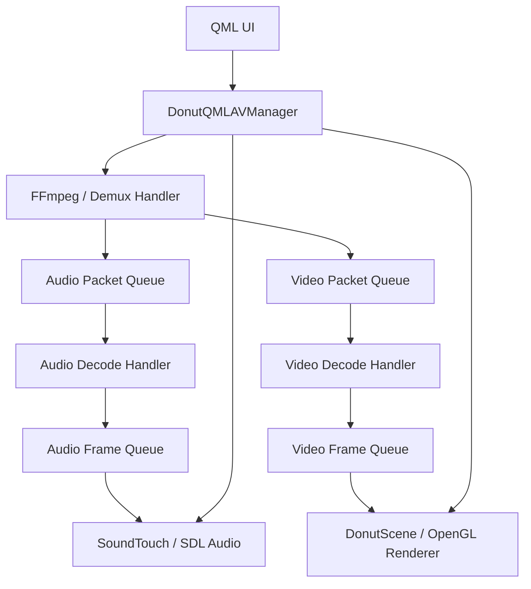
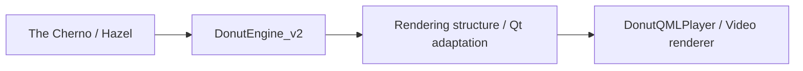

# DonutQMLPlayer

**日本語** | [简体中文](README.zh-CN.md)

**C++・Qt Quick / QML・FFmpegを組み合わせた、デスクトップ向け動画プレーヤーです。**

音声・映像の再生処理をC++のクラスに整理し、QMLの操作画面と連携させた個人開発プロジェクトです。FFmpegによるデコード、SDLによる音声出力、SoundTouchによる速度調整、OpenGLによる映像描画を組み合わせています。

開発では、再生機能に加えて、**処理の分離、スレッド間のデータ受け渡し、QMLとC++の接続、描画リソースの管理**に取り組みました。

描画層には、The Chernoのシリーズを参考に学習した[DonutEngine_v2](https://github.com/Seppura-y/DonutEngine_v2)の構造を応用しています。シェーダー、テクスチャー、バッファー、描画コマンドを動画表示向けに整理し、Qt Quick上で動作するレンダラーへ組み込みました。


## 開発の目的

- FFmpegのAPIをアプリケーションから扱いやすいクラスにまとめ、プレーヤーの内部構造を理解する。
- UI、再生制御、デコード、音声出力、映像描画の役割を分ける。
- QMLの操作をC++の処理につなぎ、再生状態を画面へ反映する。
- DonutEngine_v2で学んだOpenGL描画層をQtへ適合させ、動画表示と座標変換に利用する。

## 主な機能

| 分類 | 内容 |
|---|---|
| メディア入力 | ローカルファイルの選択、プレイリストへの追加、音声・映像ストリームの読み込み |
| 再生操作 | 再生／一時停止、再生位置の指定、再生時間の表示 |
| 音声 | SDLによる出力、音量・ミュート操作、SoundTouchによるピッチを維持した再生速度の調整 |
| 映像 | OpenGLによる描画、X・Y・Z軸の回転操作、行列による位置・拡大率の制御 |
| UI | QMLのコントロールバー、プレイリスト、音量ポップアップ、映像設定パネル |

対応するメディア形式は、使用するFFmpegのビルド構成に依存します。

## 構成



### 1. 再生処理のクラス分割

ffplayの処理構成を参考に、解多重化、デコード、Packet／Frameの管理、音声出力、映像表示を分けています。圧縮データであるPacketと、デコード後のFrameを区別し、処理段階ごとのキューを介して受け渡す構成です。

再生位置の変更では、入力位置の変更と世代番号（serial）の更新を扱います。古いデータと新しい再生位置のデータを区別する仕組みや、キュー・デコーダー・クロックの関係が、このプロジェクトで取り組んだテーマの一つです。

### 2. QMLとC++の連携

画面の構成と操作イベントをQMLに、メディア処理をC++に置いています。`DonutQMLAVManager`の公開メソッドを通して、再生／一時停止、音量、速度、再生位置、映像の回転を操作します。

UI側がFFmpegやSDLのAPIを直接呼ばない構成にすることで、表示と再生処理の境界を明確にしています。

### 3. DonutEngine_v2の描画構造を動画レンダラーへ応用

The ChernoのシリーズとHazelを参考に取り組んだ[DonutEngine_v2](https://github.com/Seppura-y/DonutEngine_v2)から、動画表示に必要な描画構造を整理・簡略化しました。エンジンで学んだリソース管理と描画の分離を、Qtアプリケーションの中で使うことに取り組んでいます。

| 元のエンジンで扱った構造 | このプレーヤーでの適用 |
|---|---|
| `RenderCommand`／`RendererAPI` | `DonutRenderCommand`／`DonutGLRendererApi`を通した描画呼び出し |
| OpenGLのリソースラッパー | QtのOpenGL関数を使うShader、Texture、Buffer、VertexArray、Framebufferのクラス |
| `Renderer2D`の描画構成 | `DonutSceneRenderer`による矩形と動画の描画 |
| カメラ・座標変換 | 動画の回転、位置、拡大率の制御 |
| テクスチャー更新 | デコードしたフレームのY・U・Vデータを描画側へ渡す処理 |

OpenGL呼び出しは、`QOpenGLFunctions_4_5_Core`を使う`DonutGLRendererApi`などを通して行います。動画の表示側は`DonutScene`を`QQuickItem`として構成し、Qt Quickの同期・描画・リソース解放のタイミングへ接続しています。

### 4. 動画フレームと描画タイミングの接続

画像を一度読み込んで描く処理に加えて、動画ではデコード後のフレームを継続的に受け取り、テクスチャーを更新します。`DonutScene`から`DonutSceneRenderer::updateYuvTextures()`へデータを渡し、Y・U・Vのテクスチャーを使って描画する処理を用意しています。

フレームの画素形式、メモリー配置、再生時刻と、Qt側の描画タイミングをつなぐ部分が、ゲームエンジンの描画を動画プレーヤーへ適用する際の主な実装テーマです。

## 学習から応用への流れ



DonutEngine_v2では描画とエディターの仕組みを学び、このプロジェクトでは描画層を動画用途に適合させています。Qtとの接続には[donut_scene.cpp](src/player/donut_scene.cpp)、動画描画には[donut_scene_renderer.cpp](src/renderer/donut_scene_renderer.cpp)、OpenGL APIの適合には[donut_gl_renderer_api.h](src/renderer/donut_gl_renderer_api.h)を使用しています。

## ソースコードの見どころ

| ファイル／ディレクトリー | 役割 |
|---|---|
| [src/main.qml](src/main.qml) | 画面構成と操作イベントの接続 |
| [src/player/donut_qml_av_manager.cpp](src/player/donut_qml_av_manager.cpp) | 再生パイプラインと操作の管理 |
| [src/handler/](src/handler/) | 解多重化・デコードの処理単位 |
| [src/media/media_data/](src/media/media_data/) | Packet、Frame、キュー、クロック関連の型 |
| [src/player/donut_sdl_audio_player.cpp](src/player/donut_sdl_audio_player.cpp) | SDLとSoundTouchを使った音声処理 |
| [src/player/donut_scene.cpp](src/player/donut_scene.cpp) | Qt Quick側の映像表示との接続 |
| [src/renderer/](src/renderer/) | OpenGLのリソースと描画処理 |
| [src/renderer/donut_scene_renderer.cpp](src/renderer/donut_scene_renderer.cpp) | エンジンの描画構成を基にした矩形描画とYUVテクスチャー処理 |
| [src/renderer/donut_gl_renderer_api.h](src/renderer/donut_gl_renderer_api.h) | QtのOpenGL関数を使う描画API |

最初に`main.qml`と`donut_qml_av_manager.cpp`を読むと、UIから再生処理までの流れを追いやすくなっています。

## 使用技術

| 技術 | 用途 |
|---|---|
| C++20 | 現在のCMake設定で指定する言語標準 |
| Qt 6 / Qt Quick / QML | GUI、C++連携、描画コンテキスト |
| FFmpeg | メディア入力、デコード、フォーマット変換 |
| SDL2 | 音声デバイスへの出力 |
| SoundTouch | 音声のテンポ・ピッチ処理 |
| OpenGL / GLM | 映像描画、座標変換 |
| spdlog / stb_image | ログ、画像読み込み |
| CMake 3.22以上 | ビルド設定 |

## ビルドと実行

現在のビルド設定はWindowsを対象としています。付属のバッチファイルではQt 6.6.3のMSVC用キットを指定しています。Qt、コンパイラー、外部ライブラリーのアーキテクチャーと構成をそろえてください。

描画APIには`QOpenGLFunctions_4_5_Core`を使用するため、対応するOpenGL環境が必要です。

### 事前準備

リポジトリーには依存ファイルの一部のみを含めています。ビルド前に、[CMakeLists.txt](CMakeLists.txt)と[src/qml.qrc](src/qml.qrc)に記載された参照先を用意する必要があります。

- `include/glm/`、`include/stb_image/`、`include/soundtouch/`の依存ファイル。
- `lib/`内のFFmpeg・SDL2等のリンク用ライブラリーと、実行時に必要なDLL。
- QRCに記載されたフォントなどのリソース。
- `bin/assets/shaders/`を含む実行時リソースの配置。

### コマンド例

依存ファイルを配置した後、利用するQtキットのパスに合わせて設定します。以下はPowerShellでの例です。

```powershell
cmake -S . -B build -DCMAKE_PREFIX_PATH="C:/Qt/6.6.3/msvc2019_64"
cmake --build build --config Release
& "C:/Qt/6.6.3/msvc2019_64/bin/windeployqt.exe" "./bin/DonutQMLPlayer.exe" --qmldir "./src"
```

`windeployqt`とは別に、FFmpegやSDL2などの実行時DLLも配置します。シェーダーの相対パスを解決できるよう、`bin/`を作業ディレクトリーとして起動します。

```powershell
Push-Location ./bin
./DonutQMLPlayer.exe
Pop-Location
```

付属の`build.bat`は主にCMakeの構成生成を行います。利用する場合は、`build.bat`と`install.bat`のQtパスを環境に合わせて変更してください。

## 現在の範囲

再生処理と描画の構造を学び、アプリケーションとして組み合わせることを目的としたプロジェクトです。プレイリストの連続再生、一部の操作APIや設定画面には実装途中の部分があります。Windows以外の環境については、このリポジトリーでの動作保証は行っていません。

## その他の画面例


## 参考にした実装

- [FFmpeg / ffplay](https://github.com/FFmpeg/FFmpeg/blob/master/fftools/ffplay.c)：再生処理、キュー、同期などの構成。
- [The Cherno / Hazel](https://github.com/TheCherno/Hazel)：ゲームエンジンと描画層の設計・実装の学習元。
- [DonutEngine_v2](https://github.com/Seppura-y/DonutEngine_v2)：上記を参考に取り組んだエンジン。本プレーヤーへ描画構造を応用する基になったプロジェクト。

音声・映像処理のC++によるラッパー化と、エンジンで学んだ描画構造のQt Quickへの適用を組み合わせたプロジェクトです。
