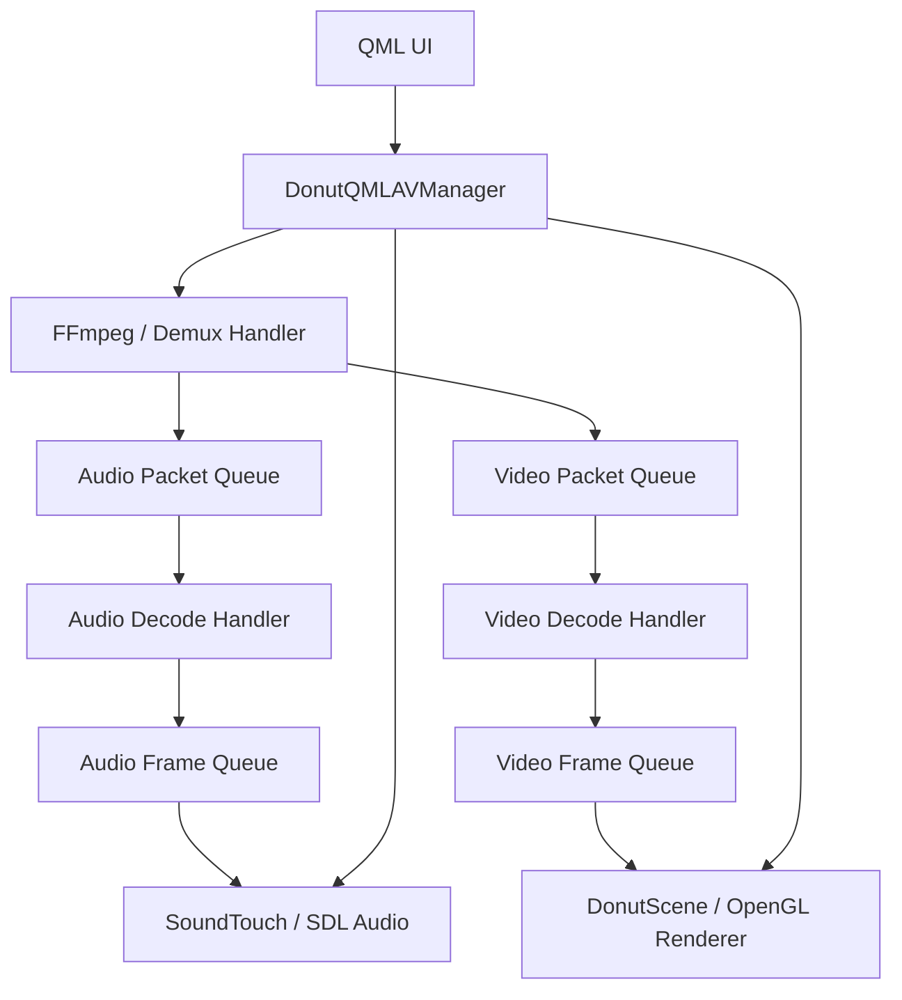
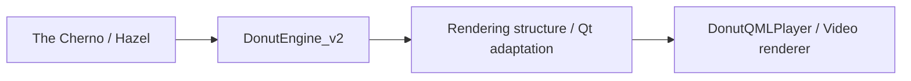

# DonutQMLPlayer

[日本語](README.md) | **简体中文**

**使用 C++、Qt Quick / QML 和 FFmpeg 构建的桌面视频播放器。**

这是一个将音视频播放流程整理为 C++ 类，并与 QML 操作界面连接的个人项目。项目结合 FFmpeg 解码、SDL 音频输出、SoundTouch 变速处理和 OpenGL 视频渲染。

除播放功能外，开发中重点实践了**处理职责的分离、线程间的数据传递、QML 与 C++ 的连接，以及渲染资源管理**。

渲染层应用了参考 The Cherno 系列学习的 [DonutEngine_v2](https://github.com/Seppura-y/DonutEngine_v2) 中的结构，将着色器、纹理、缓冲区和绘制命令按视频显示需求进行整理，接入 Qt Quick 的渲染流程。


## 开发目标

- 将 FFmpeg API 整理为便于应用层使用的类，理解播放器的内部结构。
- 分离 UI、播放控制、解码、音频输出和视频渲染的职责。
- 将 QML 操作连接到 C++ 处理流程，并将播放状态反馈到界面。
- 将 DonutEngine_v2 中学习的 OpenGL 渲染层适配到 Qt，用于视频显示与坐标变换。

## 主要功能

| 分类 | 内容 |
|---|---|
| 媒体输入 | 选择本地文件、添加到播放列表、读取音视频流 |
| 播放操作 | 播放／暂停、指定播放位置、显示播放时间 |
| 音频 | SDL 输出、音量与静音控制、通过 SoundTouch 实现保持音调的变速播放 |
| 视频 | OpenGL 渲染、沿 X／Y／Z 轴旋转、通过矩阵控制位置与缩放 |
| UI | QML 控制栏、播放列表、音量弹窗、视频设置面板 |

支持的媒体格式取决于所使用的 FFmpeg 构建配置。

## 整体结构



### 1. 将播放流程拆分为不同的类

参考 ffplay 的处理结构，将解复用、解码、Packet／Frame 管理、音频输出和视频显示分别组织。区分压缩数据 Packet 与解码后的 Frame，通过不同处理阶段的队列传递数据。

跳转播放位置时，处理输入位置的变化与序列号（serial）的更新。区分旧数据与新播放位置的数据，以及理解队列、解码器和时钟之间的关系，是本项目的实践重点之一。

### 2. QML 与 C++ 的连接

界面结构和操作事件放在 QML 中，媒体处理放在 C++ 中。通过 `DonutQMLAVManager` 的公开方法控制播放／暂停、音量、速度、播放位置和画面旋转。

UI 不直接调用 FFmpeg 或 SDL API，使界面显示与播放处理之间的边界更清楚。

### 3. 将 DonutEngine_v2 的渲染结构应用到视频渲染器

从参考 The Cherno 系列与 Hazel 学习的 [DonutEngine_v2](https://github.com/Seppura-y/DonutEngine_v2) 中，整理并简化视频显示所需的渲染结构。将引擎学习中的资源管理与绘制分离应用到 Qt 程序中。

| 原引擎中的结构 | 在播放器中的应用 |
|---|---|
| `RenderCommand`／`RendererAPI` | 通过 `DonutRenderCommand`／`DonutGLRendererApi` 发起绘制调用 |
| OpenGL 资源封装 | 使用 Qt OpenGL 函数的 Shader、Texture、Buffer、VertexArray、Framebuffer 类 |
| `Renderer2D` 的绘制结构 | 通过 `DonutSceneRenderer` 绘制矩形和视频 |
| 相机与坐标变换 | 控制视频的旋转、位置和缩放 |
| 纹理更新 | 将解码帧的 Y／U／V 数据传递给渲染端 |

OpenGL 调用通过使用 `QOpenGLFunctions_4_5_Core` 的 `DonutGLRendererApi` 等类完成。视频显示端将 `DonutScene` 实现为 `QQuickItem`，连接 Qt Quick 的同步、绘制和资源释放时机。

### 4. 连接视频帧与渲染时机

与读取一次图片再绘制的处理不同，视频需要持续接收解码后的帧并更新纹理。项目从 `DonutScene` 向 `DonutSceneRenderer::updateYuvTextures()` 传递数据，使用 Y／U／V 纹理完成绘制。

连接帧的像素格式、内存布局、播放时刻与 Qt 的绘制时机，是将游戏引擎渲染结构应用到视频播放器时的主要实现主题。

## 从学习到应用



在 DonutEngine_v2 中学习渲染与编辑器的工作机制，在本项目中将渲染层适配到视频用途。与 Qt 的连接见 [donut_scene.cpp](src/player/donut_scene.cpp)，视频绘制见 [donut_scene_renderer.cpp](src/renderer/donut_scene_renderer.cpp)，OpenGL API 适配见 [donut_gl_renderer_api.h](src/renderer/donut_gl_renderer_api.h)。

## 源码阅读入口

| 文件／目录 | 职责 |
|---|---|
| [src/main.qml](src/main.qml) | 界面结构与操作事件连接 |
| [src/player/donut_qml_av_manager.cpp](src/player/donut_qml_av_manager.cpp) | 播放流程与操作管理 |
| [src/handler/](src/handler/) | 解复用与解码处理单元 |
| [src/media/media_data/](src/media/media_data/) | Packet、Frame、队列和时钟相关类型 |
| [src/player/donut_sdl_audio_player.cpp](src/player/donut_sdl_audio_player.cpp) | 使用 SDL 和 SoundTouch 进行音频处理 |
| [src/player/donut_scene.cpp](src/player/donut_scene.cpp) | 与 Qt Quick 视频显示端连接 |
| [src/renderer/](src/renderer/) | OpenGL 资源与绘制处理 |
| [src/renderer/donut_scene_renderer.cpp](src/renderer/donut_scene_renderer.cpp) | 基于引擎绘制结构的矩形绘制与 YUV 纹理处理 |
| [src/renderer/donut_gl_renderer_api.h](src/renderer/donut_gl_renderer_api.h) | 使用 Qt OpenGL 函数的绘制 API |

建议先阅读 `main.qml` 和 `donut_qml_av_manager.cpp`，了解从 UI 到播放处理的调用流程。

## 技术栈

| 技术 | 用途 |
|---|---|
| C++20 | 当前 CMake 配置指定的语言标准 |
| Qt 6 / Qt Quick / QML | GUI、C++ 交互、渲染上下文 |
| FFmpeg | 媒体输入、解码、格式转换 |
| SDL2 | 音频设备输出 |
| SoundTouch | 音频速度与音调处理 |
| OpenGL / GLM | 视频渲染、坐标变换 |
| spdlog / stb_image | 日志、图片读取 |
| CMake 3.22 及以上 | 构建配置 |

## 构建与运行

当前构建配置面向 Windows。仓库中的批处理文件指定了 Qt 6.6.3 的 MSVC Kit；请确保 Qt、编译器及外部库的架构和构建配置一致。

绘制 API 使用 `QOpenGLFunctions_4_5_Core`，需要对应的 OpenGL 环境。

### 准备依赖

仓库只包含部分依赖文件。构建前，需要准备 [CMakeLists.txt](CMakeLists.txt) 和 [src/qml.qrc](src/qml.qrc) 中引用的文件。

- `include/glm/`、`include/stb_image/`、`include/soundtouch/` 中的依赖文件。
- `lib/` 中 FFmpeg、SDL2 等链接库，以及运行时所需的 DLL。
- QRC 中引用的字体等资源。
- 包含 `bin/assets/shaders/` 在内的运行资源。

### 命令示例

准备好依赖后，根据实际使用的 Qt Kit 修改路径。以下命令在 PowerShell 中执行。

```powershell
cmake -S . -B build -DCMAKE_PREFIX_PATH="C:/Qt/6.6.3/msvc2019_64"
cmake --build build --config Release
& "C:/Qt/6.6.3/msvc2019_64/bin/windeployqt.exe" "./bin/DonutQMLPlayer.exe" --qmldir "./src"
```

除 `windeployqt` 部署的文件外，还需放置 FFmpeg、SDL2 等运行时 DLL。使用 `bin/` 作为工作目录启动程序，以便正确解析着色器的相对路径。

```powershell
Push-Location ./bin
./DonutQMLPlayer.exe
Pop-Location
```

仓库中的 `build.bat` 主要用于生成 CMake 构建配置。使用时请将 `build.bat` 和 `install.bat` 中的 Qt 路径改为本机路径。

## 当前范围

本项目用于学习播放流程与渲染结构，并将它们组合为应用程序。播放列表连续播放、部分操作 API 和设置界面仍有未完成的部分。本仓库尚未保证 Windows 之外环境的运行情况。

## 更多界面


## 参考实现

- [FFmpeg / ffplay](https://github.com/FFmpeg/FFmpeg/blob/master/fftools/ffplay.c)：播放流程、队列、同步等结构。
- [The Cherno / Hazel](https://github.com/TheCherno/Hazel)：游戏引擎与渲染层设计、实现的学习来源。
- [DonutEngine_v2](https://github.com/Seppura-y/DonutEngine_v2)：参考上述内容学习的引擎项目，也是本播放器渲染结构的应用来源。

本项目结合了音视频处理的 C++ 封装，以及从引擎学习中整理的渲染结构在 Qt Quick 中的应用。
